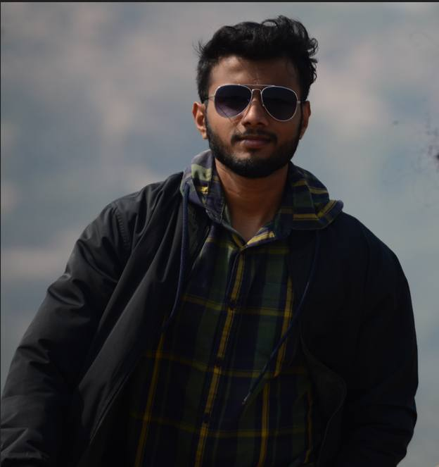

# 🎬 Creative Portfolio — Akshat Dange

<p align="center">
  
</p>

<p align="center">
  <strong>Filmmaker • Video Editor • Visual Storyteller • Content Creator</strong><br />
  <em>Pune, Maharashtra, India</em>
</p>

<p align="center">
  <a href="https://github.com/aksh-dash/Creative-Portfolio"></a>
  <a href="https://vitejs.dev/"></a>
  <a href="https://developer.mozilla.org/en-US/docs/Web/CSS"></a>
  <a href="https://lucide.dev/"></a>
  
</p>

---

## 🌟 Overview

Welcome to the official repository of **Akshat Dange's Creative Portfolio**. 

Built from the ground up with high performance, dark luxury aesthetics, and cinematic visuals in mind, this web application presents a curated body of work across cinematography, client commercials, short-form viral reels, photography, color grading, and graphic design.

> **"I build frames for feelings."**  
> Owning the complete creative pipeline: Concept ➔ Script & Hook ➔ Production & Shoot ➔ Edit & Sound Design ➔ Color Grade ➔ Distribution.

---

## 🚀 Key Features

### 1. 🎞️ Cinematic Showreel & Buffer-Free Video Vault
- **Preload-Optimized Player**: Configured with `preload="none"` and an interactive custom click-to-play overlay to eliminate artificial scrubber progress bars on load.
- **Categorized Video Vault**: Dedicated multi-video galleries for:
  - **Creatively Lensed**: Narrative commercials and creative experiments.
  - **Automotive**: High-octane car and bike cinematography.
  - **Gymophilic**: Fitness and training short-form reels.
  - **NextGen**: Contemporary brand promotions.
  - **E-Cell RSCOE**: Flagship college entrepreneurship event coverages.

### 2. 🎨 Interactive Before / After Color Grading
- Dual interactive split-screen wipe sliders comparing RAW flat camera profiles against finalized DaVinci Resolve / Premiere Pro color grades.
- Real-time touch and mouse drag support with smooth boundary-clamping.

### 3. 📸 High-Resolution Photography & Visual Art
- Curated responsive gallery featuring Portraits, Street, Architecture, Jewelry, Commercial Products, and Nature.
- Interactive modal lightbox for full-screen inspection.

### 4. 🗂️ 6-Card Single-Window Project Showcase
- Compact 3×2 grid displaying all key clients and ventures (`Gymophilic`, `Creatively Lensed`, `NextGen`, `Visdom Studios`, `Automotive`, `E-Cell RSCOE`).
- Fitted with non-distorting `object-fit: contain` branding cards that respect viewport heights on desktop and mobile screens.

### 5. ⏳ Chronological Career Timeline
- Strict chronological career progression:
  1. **2019 – Present**: Founder & Creative Director — *Creatively Lensed*
  2. **2024 – Present**: Co-Founder & Media Head — *Gymophilic*
  3. **March 2024 – Oct 2025**: Media & Design Lead — *E-Cell RSCOE*
  4. **July 2025 – Present**: Video & Media Associate — *Visdom Studios*

### 6. 🛡️ Client-Side Asset Protection (Security Patch)
- Built-in `securityPatch.js` utility protecting intellectual property:
  - Disables right-click context menus (`contextmenu` event interception).
  - Restricts unauthorized media dragging on `` and `<video>` tags.
  - Blocks common inspect shortcut key combinations (`F12`, `Ctrl+Shift+I`, `Ctrl+Shift+J`, `Ctrl+Shift+C`, `Ctrl+U`).

### 7. ⚖️ Legal & SEO Compliance
- **Legal Modals**: Integrated Privacy Policy and Terms & Conditions modals.
- **User Privacy**: Persistent Cookie consent banner with localStorage state.
- **SEO Ready**: Custom 404 page, canonical metadata, Open Graph / Twitter cards, `robots.txt`, and XML `sitemap.xml`.

---

## 🛠️ Tech Stack

- **Frontend Framework**: [React 18](https://react.dev/)
- **Bundler & Dev Server**: [Vite 8](https://vitejs.dev/)
- **Styling**: Vanilla Modern CSS (Tailored HSL design system, CSS variables, glassmorphism, fluid clamp typography)
- **Icons**: [Lucide React](https://lucide.dev/)
- **Audio/Video**: Native HTML5 Video APIs with lazy loading and custom overlay controls
- **Deployment**: Static SPA optimized for Vercel, Netlify, or GitHub Pages

---

## 📂 Project Structure

```text
CREATIVE LENSES PORTFOLIO/
├── Public/
│   ├── assets/              # Compressed brand logos, hero portrait, banners
│   ├── graphics/            # Design posters, event collaterals
│   ├── photography/         # High-res photo collection & client sets
│   ├── videos/              # Segmented video assets (gymophilic, automotive, etc.)
│   ├── favicon.svg          # Portfolio favicon
│   ├── robots.txt           # Search crawler directives
│   └── sitemap.xml          # XML sitemap for SEO indexation
├── src/
│   ├── components/
│   │   ├── hero.jsx         # Clean split hero with centered headroom
│   │   ├── Navbar.jsx       # Floating navigation bar with smooth scroll
│   │   ├── Showreel.jsx     # Buffer-free cinematic video player
│   │   ├── Projects.jsx     # 3x2 project grid with containment styling
│   │   ├── BeforeAfter.jsx  # Interactive color grading wipe comparison
│   │   ├── Photography.jsx  # Photography gallery & lightbox
│   │   ├── Graphics.jsx     # Graphic design showcase
│   │   ├── Timeline.jsx     # Career & venture milestones
│   │   ├── Services.jsx     # End-to-end creative service offerings
│   │   ├── Contact.jsx      # Direct reach-out form & Instagram links
│   │   ├── NotFound.jsx     # Custom 404 error page
│   │   ├── CookieBanner.jsx # Privacy cookie banner
│   │   ├── PrivacyPolicyModal.jsx
│   │   └── TermsModal.jsx
│   ├── data/
│   │   └── portfolioData.js # Single source of truth for portfolio content
│   ├── styles/              # Dedicated CSS modules for each component
│   ├── utils/
│   │   └── securityPatch.js # Anti-theft context menu & inspect lock
│   ├── App.jsx              # Root application router and layout
│   └── main.jsx             # React DOM entry point
├── index.html               # Semantic HTML5 entry with meta & OG tags
├── package.json             # Dependencies and scripts
└── vite.config.js           # Vite build configuration
```

---

## ⚡ Getting Started Locally

### Prerequisites
Make sure you have **Node.js** (version 18 or higher) and **npm** installed on your system.

### 1. Clone the repository
```bash
git clone https://github.com/aksh-dash/Creative-Portfolio.git
cd Creative-Portfolio
```

### 2. Install dependencies
```bash
npm install
```

### 3. Start development server
```bash
npm run dev
```
Open your browser and navigate to `http://localhost:5173` to explore the website live.

### 4. Build for production
```bash
npm run build
```
The optimized static build will be compiled into the `dist/` directory ready for deployment.

### 5. Preview production build locally
```bash
npm run preview
```

---

## 📬 Connect & Collaborate

- **Email**: [creativelensesstore@gmail.com](mailto:creativelensesstore@gmail.com) • [dange.akshat2107@gmail.com](mailto:dange.akshat2107@gmail.com)
- **Phone / WhatsApp**: [+91 8482872105](https://wa.me/918482872105)
- **Location**: Pune, Maharashtra, India

### Official Instagram Handles
- 📸 Personal: [@dangeakshat](https://instagram.com/dangeakshat)
- 🎬 Filmmaking & Production: [@creativelylensed](https://instagram.com/creativelylensed)
- 🏋️ Fitness Media: [@gymophilic](https://instagram.com/gymophilic)
- 🏎️ Automotive Club: [@carclubofsambhajinagar](https://www.instagram.com/carclubofsambhajinagar)

---

<p align="center">
  <sub>© 2026 Akshat Dange. All media assets, cinematography, and photographs are proprietary and protected under Creative Lenses.</sub>
</p>